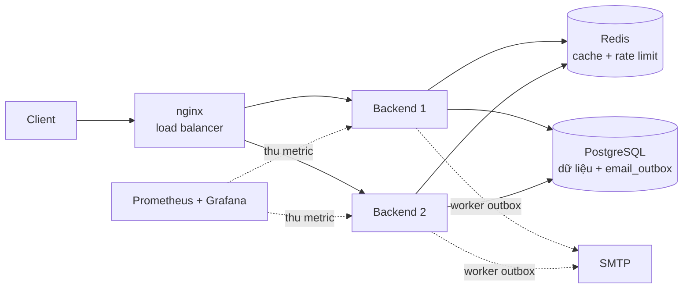

# 7. Kế hoạch cải thiện kiến trúc Pha 2

Pha 2 không thêm nghiệp vụ mới. Mục tiêu là sửa các hạn chế kiến trúc của Pha 1 và chứng minh từng cải thiện bằng số đo trước và sau.

Các vấn đề chia làm hai nhóm:

- **Nhóm A:** hạn chế mà tài liệu Pha 1 đã tự ghi nhận. Ưu tiên làm trước.
- **Nhóm B:** vấn đề tìm thấy khi đọc mã nguồn, tài liệu Pha 1 chưa nêu.

## 7.1. Số đo trước khi cải thiện (baseline)

Baseline Pha 1 không làm lộ vấn đề nào vì dữ liệu chỉ có 5 chuyến xe. Pha 2 đo lại trên 100.000 chuyến xe và 285.000 booking, chạy trên Kaggle CPU (4 CPU) để mọi lần đo dùng cùng loại máy.

| Tình huống | Người dùng ảo | RPS | p95 (ms) | Lỗi |
|---|---|---|---|---|
| Xem toàn bộ chuyến xe | 5 | 0,84 | 7.800 | 0% |
| Tìm chuyến theo tuyến và ngày | 20 | 46,7 | 33 | 0% |
| Tìm chuyến theo tuyến và ngày | 100 | 146,4 | 320 | 0% |
| Nhiều người đặt cùng một chuyến | 100 | 219,3 | 70 | 0% |
| Nhiều người đặt cùng một chuyến | 400 | 273,2 | 1.600 | 0% |
| Đăng ký, mail server hoạt động | 20 | 29,9 | 400 | 0% |
| Đăng ký, mail server bị treo | 20 | 3,4 | 5.100 | 100% |

Không có chuyến nào bị bán vượt ghế.

- Bảng đầy đủ: [`load-tests/results/phase2_baseline/REPORT.md`](../load-tests/results/phase2_baseline/REPORT.md).
- Cách đo lại: chạy notebook [`busbooking-kaggle-cpu-test-phase2.ipynb`](../load-tests/notebook/busbooking-kaggle-cpu-test-phase2.ipynb) với file JAR mới và đổi giá trị `STAGE`.

## 7.2. Nhóm A

### A1. Tìm chuyến trả về toàn bộ danh sách và thiếu index

**Vấn đề:** `GET /api/trips` trả về mọi chuyến xe trong một lần gọi, và các bảng `trips`, `bookings` thiếu index. Với 100.000 chuyến, một request mất gần 8 giây.

**Xử lý:**

- Phân trang cho `GET /api/trips`, lịch sử booking và các danh sách quản trị.
- Mặc định chỉ trả chuyến `SCHEDULED` chưa khởi hành.
- Thêm index bằng migration V17: `trips(route_id, departure_time)`, `bookings(user_id)`, `bookings(trip_id)`.

**Kết quả mong đợi:** xem danh sách chuyến còn vài chục ms; tìm chuyến ở 100 người dùng không còn phải chờ kết nối database.

### A2. Chưa có cache cho các API đọc

**Vấn đề:** mọi lượt đọc đều truy vấn PostgreSQL, kể cả dữ liệu hiếm khi thay đổi như danh sách địa điểm.

**Xử lý:**

- Thêm Redis.
- Cache danh sách địa điểm (thời hạn dài) và kết quả tìm chuyến (thời hạn 30–60 giây).
- Số ghế khi đặt vé vẫn kiểm tra tại database, không lấy từ cache.

**Kết quả mong đợi:** giảm số truy vấn tới PostgreSQL. Làm sau A1; nếu A1 đã đủ nhanh thì độ trễ chỉ giảm thêm ít.

### A3. Nhiều người đặt cùng một chuyến làm chậm cả hệ thống

**Vấn đề:** các lượt đặt vé trên cùng một chuyến phải xếp hàng chờ khóa, và trong lúc chờ chúng giữ hết 10 kết nối database. Ở 400 người dùng, cả những request không liên quan (xem chi tiết chuyến) cũng chậm từ 4 ms lên 1.100 ms.

**Xử lý:**

- Đặt thời hạn chờ khóa; quá hạn thì trả lỗi `409` hoặc `503` thay vì tiếp tục chờ.
- Cấu hình rõ kích thước pool kết nối và thời hạn chờ kết nối.
- Giới hạn số lượt đặt vé chạy cùng lúc, để chúng không chiếm hết kết nối.
- Giữ nguyên cách khóa hiện tại (`SELECT … FOR UPDATE`), vì nó đang đảm bảo không bán vượt ghế.

**Kết quả mong đợi:** các request khác vẫn nhanh khi có một chuyến "hot". Tốc độ đặt vé trên chính chuyến đó không tăng, và một phần lượt đặt sẽ bị từ chối nhanh thay vì chờ lâu.

### A4. Gửi lại request đặt vé tạo ra hai booking

**Vấn đề:** nếu client gửi lại cùng một request (do mất mạng), hệ thống tạo hai booking và trừ ghế hai lần.

**Xử lý:** client gửi kèm header `Idempotency-Key`; server lưu khóa này và trả lại booking cũ nếu gặp request lặp.

**Kết quả mong đợi:** gửi cùng một request hai lần chỉ tạo một booking. Kiểm tra bằng test, không đo bằng tải.

### A5. Thiếu monitoring và logging

**Vấn đề:** Pha 1 không có công cụ nào cho biết hệ thống chậm ở đâu.

**Xử lý:**

- Actuator, Micrometer, Prometheus: **đã xong**, các số đo ở mục 7.1 lấy từ đây.
- Còn lại: Grafana để xem biểu đồ, mã liên kết (correlation ID) cho mỗi request, log dạng JSON có che thông tin nhạy cảm.

### A6. Rate limiter không dùng được khi chạy nhiều instance

**Vấn đề:** bộ đếm giới hạn request nằm trong bộ nhớ của từng instance. Chạy 2 instance thì giới hạn thực tế tăng gấp đôi, và sau reverse proxy mọi client có chung một địa chỉ IP.

**Xử lý:**

- Chuyển bộ đếm sang Redis (dùng chung với A2).
- Đọc IP thật của client từ header `X-Forwarded-For`.

**Kết quả mong đợi:** giới hạn vẫn đúng khi chạy 2 instance. Kiểm tra bằng test.

### A7. Chưa có health check, nhiều instance và CI/CD

**Vấn đề:** chỉ có một backend, nó chết là cả hệ thống ngừng. Không có health check cho backend và không có pipeline tự động chạy test.

**Xử lý:**

- Health check cho backend.
- nginx làm load balancer trước 2 instance backend.
- Chạy migration database thành một bước riêng trước khi backend khởi động.
- Pipeline GitHub Actions: chạy test, build image.

**Kết quả mong đợi:** tắt một instance thì hệ thống vẫn phục vụ. Chạy 2 instance trên cùng một máy không làm tăng RPS.

### A8. Lỗi cấu hình SMTP khi chạy bằng Compose

**Đã xong** (commit `dbe76c9`): bỏ profile `dev`, mọi cấu hình lấy từ biến môi trường.

## 7.3. Nhóm B

### B1. Gửi email OTP ngay trong lúc xử lý request

**Vấn đề:** đăng ký phải chờ gửi mail xong mới trả kết quả. Khi mail server treo, mỗi lượt đăng ký chờ 5 giây rồi báo lỗi, dù tài khoản đã được tạo.

**Xử lý:** ghi yêu cầu gửi mail vào một bảng trong database (mẫu outbox); một tiến trình nền gửi mail và tự thử lại khi lỗi.

**Kết quả mong đợi:** đăng ký trả kết quả ngay, không phụ thuộc mail server.

### B2. Mỗi request có đăng nhập đều truy vấn bảng users

**Vấn đề:** mỗi request kèm token đều đọc lại thông tin người dùng từ database.

**Xử lý:** cache thông tin người dùng trong Redis với thời hạn ngắn. Chỉ làm nếu còn thời gian.

### B3. Mã nguồn chia theo tầng, các phần phụ thuộc chéo nhau

**Vấn đề:** tài liệu gọi hệ thống là modular monolith, nhưng mã nguồn chia theo tầng kỹ thuật và không có gì ngăn các phần gọi lẫn nhau.

**Xử lý:** thêm test ArchUnit để tự động kiểm tra ranh giới giữa các module. Không tổ chức lại toàn bộ mã nguồn.

## 7.4. Ngoài phạm vi Pha 2

Các mục sau là tính năng mới, không phải cải thiện kiến trúc:

- Hoàn tiền, hủy hàng loạt booking, thông báo khi hủy chuyến.
- Hạn chót hủy vé; chặn đặt chuyến đã quá giờ.
- Chọn ghế cụ thể, giữ chỗ, thanh toán.

PostgreSQL vẫn là một instance duy nhất; bản sao hoặc dự phòng cho database cũng nằm ngoài phạm vi.

## 7.5. Thứ tự thực hiện

| Bước | Việc | Mục | Trạng thái |
|---|---|---|---|
| 1 | Cấu hình SMTP qua biến môi trường | A8 | Đã xong |
| 2 | Actuator, metric | A5 | Đã xong |
| 3 | Dữ liệu lớn, kịch bản tải, baseline | 7.1 | Đã xong |
| 4 | Phân trang và index | A1 | |
| 5 | Redis, cache API đọc | A2 | |
| 6 | Thời hạn chờ khóa, pool, giới hạn đặt vé đồng thời, idempotency | A3, A4 | |
| 7 | Outbox cho email | B1 | |
| 8 | Rate limiter dùng Redis | A6 | |
| 9 | nginx, 2 instance, health check | A7 | |
| 10 | CI, test ArchUnit, Grafana, log | A5, A7, B3 | |
| 11 | Đo lại toàn bộ, lập bảng so sánh trước và sau | | |

Sau mỗi bước 4, 5, 6, 7: build JAR mới và chạy lại notebook, để biết từng thay đổi cải thiện được bao nhiêu.

## 7.6. Kiến trúc đích

