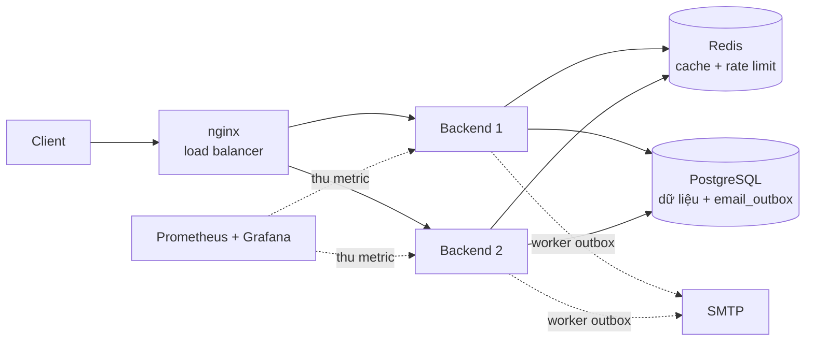

# 7. Kế hoạch cải thiện kiến trúc Pha 2

Pha 2 không thêm nghiệp vụ mới. Mục tiêu là sửa các hạn chế kiến trúc mà Pha 1 để lại, và chứng minh từng cải thiện bằng số đo trước và sau.

Tài liệu chia vấn đề thành hai nhóm:

- **Nhóm A:** hạn chế do chính tài liệu Pha 1 ghi nhận (README mục "Gợi ý cải tiến cho Pha 2" và các file trong `docs/`). Đây là phần ưu tiên.
- **Nhóm B:** vấn đề tìm thấy khi đọc mã nguồn, tài liệu Pha 1 chưa nêu thành hạn chế.

Mọi nhận định về mã nguồn dưới đây đã được đối chiếu với code ở commit `fd6b5f3`. Ảnh hưởng dưới tải lớn là suy luận, chưa đo; việc đo là bước đầu tiên của Pha 2 (mục 7.2).

## 7.1. Điểm xuất phát

Kiến trúc Pha 1: một backend Spring Boot, một PostgreSQL, một Mailpit, chạy bằng Docker Compose. Không có reverse proxy, cache, hàng đợi hay bản sao.

Baseline của Pha 1 ([`load-tests/README.md`](../load-tests/README.md)), 20 người dùng ảo trong 60 giây:

| Kịch bản | RPS | p95 (ms) | p99 (ms) | Lỗi | CPU Java |
|---|---|---|---|---|---|
| GET trips | 48,01 | 6 | 9 | 0 | 19,44% |
| POST booking | 47,21 | 25 | 40 | 0 | 83,02% |

Baseline này chưa làm lộ vấn đề nào vì ba lý do, đều do chính tài liệu load test nêu:

- Dữ liệu cho GET chỉ có 5 chuyến xe.
- POST rải trên 1.000 chuyến, mỗi chuyến 4 ghế, nên không có tranh chấp trên cùng một chuyến.
- Backend, PostgreSQL và Locust chạy chung một máy 4 CPU, mỗi mức tải chạy một lần.

## 7.2. Việc phải làm trước: đo được và có số liệu "trước"

Không có bước này thì mọi cải thiện phía sau không chứng minh được.

1. Thêm Spring Boot Actuator và Micrometer, xuất metric cho Prometheus: độ trễ theo endpoint, số lỗi, trạng thái HikariCP, thời gian chờ khóa. Micrometer không có sẵn metric chờ khóa, nên cần một Timer tự viết quanh `BookingService.create`. `SecurityConfig` đang từ chối mọi đường dẫn chưa khai báo, nên phải mở `/actuator/health` và `/actuator/prometheus`.
2. Viết script sinh dữ liệu lớn: khoảng 100.000 chuyến xe, vài trăm nghìn booking và vài trăm tài khoản `USER` đã xác minh email. Tài khoản tạo thẳng bằng SQL và JWT tự ký, vì rate limiter chỉ cho 5 lượt đăng ký và 10 lượt đăng nhập mỗi phút trên một IP. File [`busbooking_seed.sql`](../load-tests/datasets/busbooking_seed.sql) hiện quá nhỏ.
3. Bổ sung ba kịch bản tải, tái sử dụng script trong [`load-tests/scripts/`](../load-tests/scripts/):
   - **Tìm chuyến trên dữ liệu lớn:** chạy lại `get_trip_locust.py` sau khi nạp 100.000 chuyến.
   - **Chuyến "hot":** sửa `post_booking_locust.py` để dồn toàn bộ tải vào 1–5 chuyến có nhiều ghế, dùng nhiều tài khoản.
   - **SMTP lỗi:** tắt hoặc làm chậm Mailpit trong lúc gọi `POST /api/auth/register`. Nâng `AUTH_RATE_REGISTER_LIMIT` khi chạy kịch bản này, nếu không gần như mọi request nhận `429`; ghi rõ giá trị đã dùng trong báo cáo.
4. Chạy mỗi kịch bản 3 lần với cùng cấu hình máy và cùng dữ liệu, lấy trung vị của RPS, p95, p99, tỉ lệ lỗi. Đây là số liệu "trước cải thiện"; lần đo "sau" phải dùng đúng điều kiện này.

## 7.3. Nhóm A: hạn chế Pha 1 đã ghi nhận

### A1. Tìm chuyến trả về toàn bộ danh sách và thiếu index

**Nguồn:** README, mục "PostgreSQL và tìm kiếm chuyến xe"; `docs/02-database-design.md` (ghi chú về V16).

**Hiện trạng:**

- `GET /api/trips` là endpoint công khai, trả về `List<TripResponse>` không phân trang (`TripController.java`).
- Truy vấn `searchFiltered` JOIN FETCH 5 bảng. Khi không có bộ lọc, nó trả mọi chuyến, kể cả chuyến đã hủy và đã khởi hành (`SpringDataTripRepository.java`).
- Migration `V16__defer_optional_catalog_indexes.sql` đã xóa 4 index: `idx_trips_route_id`, `idx_trips_vehicle_id`, `idx_routes_destination_id`, `idx_vehicles_operator_id`.
- Chưa từng có index trên `trips.departure_time`, `bookings.user_id`, `bookings.trip_id`.

**Hướng giải quyết:**

- Phân trang cho `GET /api/trips`, lịch sử booking và các danh sách quản trị. Đặt giới hạn kích thước trang tối đa.
- Mặc định chỉ trả chuyến `SCHEDULED` có giờ khởi hành trong tương lai.
- Chạy `EXPLAIN ANALYZE` trên dữ liệu 100.000 chuyến, rồi tạo index bằng migration mới V17. Ứng viên: `trips(route_id, departure_time)`, `bookings(user_id)`, `bookings(trip_id)`. `routes(origin_id, destination_id)` đã có index qua ràng buộc UNIQUE `uk_routes_origin_destination` (V14). Không sửa V16.
- Thêm `t.id` vào `ORDER BY` của `searchFiltered` để thứ tự trang ổn định. Đổi kiểu trả về từ danh sách sang trang là thay đổi phá vỡ API: cập nhật `get_trip_locust.py` và test theo.

**Cách chứng minh:** so sánh p95 và kế hoạch truy vấn của kịch bản "tìm chuyến trên dữ liệu lớn" trước và sau. Lấy kế hoạch từ đúng câu truy vấn tham số hóa mà ứng dụng gửi, không phải câu viết tay với hằng số.

### A2. Chưa có cache cho các API đọc

**Nguồn:** README, mục "Redis Cache cho API đọc".

**Hiện trạng:** mọi lượt đọc đều xuống PostgreSQL. Dự án không có `@Cacheable` hay thư viện cache nào.

**Hướng giải quyết:**

- Thêm Redis vào Compose.
- Cache danh sách địa điểm với TTL dài, vì dữ liệu này hiếm khi đổi.
- Cache kết quả tìm chuyến theo khóa (điểm đi, điểm đến, ngày, trang) với TTL ngắn, khoảng 30–60 giây. Xóa cache khi admin tạo, sửa hoặc hủy chuyến.
- Số ghế hiển thị từ cache có thể trễ vài chục giây. Số ghế khi đặt vé vẫn được kiểm tra và cập nhật tại database trong transaction, đúng như README yêu cầu.

**Cách chứng minh:** so sánh RPS, p95 và số truy vấn tới PostgreSQL của kịch bản đọc khi bật và tắt cache.

### A3. Đặt vé đồng thời: thời gian giữ khóa, timeout, connection pool

**Nguồn:** README, mục "Booking đồng thời".

**Hiện trạng:**

- `BookingService.create` khóa dòng chuyến xe bằng `PESSIMISTIC_WRITE`, kiểm tra ghế, chạy `UPDATE` có điều kiện, rồi lưu booking. Mọi lượt đặt trên cùng một chuyến phải xếp hàng.
- `application.properties` không cấu hình kích thước pool HikariCP, lock timeout hay statement timeout. Pool vì vậy dùng mặc định 10 kết nối.
- Test đồng thời hiện có chỉ dùng 2 luồng (`TripBookingIntegrationTest`).

Cách làm hiện tại đúng về dữ liệu: không bán vượt ghế. Vấn đề là thông lượng và nguy cơ cạn pool khi nhiều người cùng đặt một chuyến.

**Hướng giải quyết:**

- Giữ nguyên `SELECT … FOR UPDATE`. Nhờ khóa trước rồi mới kiểm tra, service phân biệt được từng lỗi nghiệp vụ (không tìm thấy chuyến, chuyến không còn `SCHEDULED`, hết ghế) và trả đúng thông báo. Bỏ nó cũng không rút ngắn được thời gian giữ khóa, vì câu `UPDATE` vẫn khóa dòng chuyến xe đến khi commit.
- Đặt `lock_timeout` và `statement_timeout`. Khi hết thời gian chờ, trả `409` hoặc `503` thay vì giữ kết nối.
- Cấu hình tường minh kích thước pool HikariCP và `connection-timeout`, chọn giá trị theo số đo.

Các lượt đặt trên cùng một chuyến vẫn xếp hàng; đây là giới hạn chấp nhận được. Mục tiêu của A3 là một chuyến "hot" không làm treo phần còn lại của hệ thống, không phải tăng RPS trên chuyến đó.

**Cách chứng minh:** chạy kịch bản chuyến "hot" song song với một ít tải `GET /api/trips`, trước và sau. So sánh p99 và tỉ lệ lỗi của API đọc, số kết nối đang chờ của pool, và số request đặt vé bị từ chối nhanh thay vì treo. Kèm phép kiểm tra cân bằng ghế đã có sẵn trong notebook (`available_seats` + tổng vé `CONFIRMED` = sức chứa).

### A4. Chưa có idempotency cho đặt vé

**Nguồn:** README, mục "Booking đồng thời".

**Hiện trạng:** mã booking là UUID ngẫu nhiên sinh ở server. Client gửi lại cùng một request (do timeout mạng) sẽ tạo hai booking và trừ ghế hai lần.

**Hướng giải quyết:**

- Client gửi header `Idempotency-Key` cho `POST /api/bookings`.
- Lưu khóa cùng `user_id` trong bảng có ràng buộc UNIQUE, ghi trong cùng transaction với booking.
- Request lặp trả lại booking đã tạo, không trừ ghế thêm.

**Cách chứng minh:** gửi cùng một request hai lần, kiểm tra chỉ có một booking và số ghế chỉ giảm một lần.

### A5. Thiếu monitoring và logging

**Nguồn:** README, mục "Monitoring và logging".

**Hiện trạng:** `pom.xml` không có Actuator hay Micrometer. Mã nguồn chính gần như không ghi log. Báo cáo load test Pha 1 tự nhận chưa có profiling để xác định nguyên nhân độ trễ.

**Hướng giải quyết:**

- Actuator, Micrometer và Prometheus như mục 7.2; thêm Grafana để xem biểu đồ.
- Sinh mã liên kết (correlation ID) cho mỗi request, đưa vào MDC và header phản hồi.
- Log có cấu trúc (JSON), che email, số điện thoại, token và OTP.

**Cách chứng minh:** dashboard cho thấy độ trễ, trạng thái pool và thời gian chờ khóa trong lúc chạy các kịch bản tải.

### A6. Rate limiter nằm trong bộ nhớ, chặn việc chạy nhiều instance

**Nguồn:** README, mục "Mở rộng, Docker và CI/CD"; `docs/04-api-design.md` (ghi rõ đây là bộ đếm trong bộ nhớ).

**Hiện trạng:**

- `AuthRequestRateLimiter` là một `HashMap` sau một phương thức `synchronized`. Mỗi instance đếm riêng, nên chạy N instance thì giới hạn thực tế tăng N lần.
- Khóa đếm lấy từ `getRemoteAddr()`, và `server.forward-headers-strategy=none`. Sau reverse proxy, mọi client có cùng một địa chỉ IP.
- Khi đủ `max-keys` (mặc định 10.000), mọi khóa mới bị từ chối cho đến lượt dọn kế tiếp.

**Hướng giải quyết:**

- Chuyển bộ đếm sang Redis (dùng chung Redis của A2), tăng và đặt hạn bằng thao tác nguyên tử.
- Cấu hình proxy tin cậy và đọc IP thật từ `X-Forwarded-For`.
- Bỏ hành vi từ chối toàn bộ khi đầy; Redis tự hết hạn khóa theo TTL.

**Cách chứng minh:** chạy 2 instance sau nginx, gọi đăng nhập quá giới hạn, kiểm tra giới hạn vẫn đúng trên tổng số request.

### A7. Chưa có health check, chạy nhiều instance và CI/CD

**Nguồn:** README, mục "Mở rộng, Docker và CI/CD".

**Hiện trạng:**

- `compose.yaml` chỉ có health check cho PostgreSQL, không có cho backend. `Dockerfile` không có `HEALTHCHECK`.
- Chỉ có một backend và một PostgreSQL; backend chết là cả hệ thống ngừng.
- Flyway chạy khi ứng dụng khởi động, nên nhiều instance khởi động cùng lúc sẽ cùng chạy migration.
- Không có thư mục `.github/`; test tích hợp cần một PostgreSQL bên ngoài.

**Hướng giải quyết:**

- Health check của backend dùng endpoint readiness của Actuator, có kiểm tra kết nối database.
- Thêm nginx làm load balancer trước 2 instance backend. Backend đã không giữ phiên (JWT), nên sau khi xong A6 là chạy được nhiều instance.
- Tách migration thành một bước chạy một lần trước khi backend khởi động.
- Pipeline GitHub Actions: chạy test với PostgreSQL bằng Testcontainers hoặc service container, rồi build image.

**Cách chứng minh:** tắt một instance trong lúc chạy tải, hệ thống vẫn phục vụ; so sánh tỉ lệ lỗi với cấu hình một instance.

### A8. Lỗi cấu hình SMTP khi chạy bằng Compose (đã hoàn thành ở commit `dbe76c9`)

**Nguồn:** `docs/06-running-guide.md`, bước 2 mục chạy bằng Compose và bảng xử lý lỗi.

**Hiện trạng:** `application-dev.properties` ghi cứng `spring.mail.host=localhost`. Compose đặt `SMTP_HOST=mailpit` nhưng profile `dev` ghi đè giá trị đó, nên OTP không gửi được nếu không tự thêm `SPRING_MAIL_HOST`.

**Hướng giải quyết:** bỏ hẳn profile `dev`: xóa `application-dev.properties`, mọi cấu hình lấy từ `application.properties` qua biến môi trường (`SMTP_HOST`, `SMTP_PORT`, `API_DOCS_ENABLED`…). Đây là sửa nhỏ nhưng nên làm đầu tiên, vì kịch bản SMTP ở mục 7.2 cần luồng gửi mail chạy đúng.

## 7.4. Nhóm B: vấn đề tìm thấy trong mã, tài liệu chưa nêu thành hạn chế

### B1. Gửi email OTP đồng bộ trong luồng request

**Hiện trạng:**

- `EmailVerificationService.register` và `resend` gọi thẳng `sender.send(...)` trong luồng xử lý request. Timeout SMTP là 5 giây cho mỗi bước kết nối, đọc, ghi.
- Tài khoản được lưu trước, rồi mới gửi mail. Khi SMTP lỗi, request trả lỗi nhưng tài khoản đã tồn tại. `docs/01-overview-and-requirements.md` có mô tả hệ quả này và hướng người dùng bấm gửi lại OTP.
- Không có thử lại, hàng đợi hay bảng outbox. SMTP chậm sẽ giữ luồng Tomcat tới hết timeout.

**Hướng giải quyết:**

- Áp dụng mẫu transactional outbox: ghi yêu cầu gửi mail vào bảng `email_outbox` trong cùng transaction tạo tài khoản.
- Một worker nền đọc bảng, gửi mail, thử lại với khoảng chờ tăng dần, đánh dấu thất bại sau số lần giới hạn.
- API đăng ký trả về ngay, không phụ thuộc SMTP.
- Khi chạy nhiều instance, worker lấy việc bằng `SELECT … FOR UPDATE SKIP LOCKED` để không gửi trùng.

**Cách chứng minh:** kịch bản SMTP lỗi trước và sau. Trước: đăng ký treo 5 giây rồi lỗi. Sau: đăng ký trả ngay, mail được gửi khi SMTP hoạt động lại.

### B2. Mỗi request có xác thực đều truy vấn bảng users

**Hiện trạng:** `JwtAuthenticationFilter` gọi `users.loadById(...)` cho mỗi request có token. Access token sống 24 giờ, không có refresh token và không thu hồi được.

**Hướng giải quyết:**

- Cache thông tin người dùng trong Redis với TTL ngắn, xóa khi đổi vai trò hoặc trạng thái.
- Rút thời hạn access token xuống khoảng 15 phút và thêm refresh token. Đây là thay đổi có thêm endpoint, chỉ làm nếu còn thời gian.

**Cách chứng minh:** số truy vấn tới bảng `users` trên mỗi request trước và sau.

### B3. Package chia theo tầng, service phụ thuộc chéo

**Hiện trạng:**

- Tài liệu gọi hệ thống là modular monolith, nhưng package chia theo tầng: `api`, `business`, `domain`, `data`, `security`, `notification`.
- `TripService` dùng trực tiếp repository của Booking, Route và Vehicle. `BookingService` dùng `TripRepository`.
- Không có kiểm tra tự động nào giữ ranh giới giữa các phần.

**Hướng giải quyết:**

- Xác định các module nghiệp vụ: auth, catalog (địa điểm, tuyến, nhà xe, xe), trip, booking, notification.
- Thêm test ArchUnit để cấm phụ thuộc sai chiều. Bắt đầu bằng luật cho hiện trạng, siết dần.
- Chỉ di chuyển package cho module booking và trip, nơi các thay đổi A3, A4 diễn ra. Không tổ chức lại toàn bộ mã nguồn.

**Cách chứng minh:** test ArchUnit chạy trong CI.

## 7.5. Ngoài phạm vi Pha 2

Tài liệu Pha 1 còn ghi nhận các giới hạn nghiệp vụ dưới đây. Chúng là tính năng mới, không phải cải thiện kiến trúc, nên không làm trong Pha 2:

- Chưa có hoàn tiền, hủy hàng loạt booking, thông báo khi hủy chuyến (`docs/04-api-design.md`).
- Chưa có hạn chót hủy vé; chuyến quá giờ nhưng còn `SCHEDULED` vẫn đặt được (BR-09, BR-12 trong `docs/01-overview-and-requirements.md`).
- Ghế chỉ là bộ đếm, chưa có chọn ghế cụ thể, giữ chỗ hay thanh toán.

## 7.6. Thứ tự thực hiện

| Bước | Việc | Mục | Phụ thuộc |
|---|---|---|---|
| 1 | Bỏ profile `dev`, cấu hình SMTP qua biến môi trường (đã xong) | A8 | Không |
| 2 | Actuator, metric, correlation ID | A5, 7.2 | Không |
| 3 | Sinh dữ liệu lớn, viết 3 kịch bản tải, đo số liệu "trước" | 7.2 | Bước 1, 2 |
| 4 | Phân trang và index cho tìm chuyến | A1 | Bước 3 |
| 5 | Thêm Redis, cache API đọc | A2 | Bước 4 |
| 6 | Timeout khóa, pool, idempotency | A3, A4 | Bước 3 |
| 7 | Outbox cho email | B1 | Bước 3 |
| 8 | Rate limiter dùng Redis | A6 | Bước 5 |
| 9 | nginx, 2 instance, health check, tách migration | A7 | Bước 8 |
| 10 | CI và test ArchUnit | A7, B3 | Không |
| 11 | Đo lại cả 3 kịch bản, lập bảng so sánh trước và sau | — | Tất cả |

B2 làm sau bước 5 nếu còn thời gian.

## 7.7. Kiến trúc đích

PostgreSQL vẫn là một instance duy nhất. Bản sao đọc hoặc cơ chế dự phòng cho database nằm ngoài phạm vi; nên nêu rõ điều này như một giới hạn còn lại khi báo cáo.
